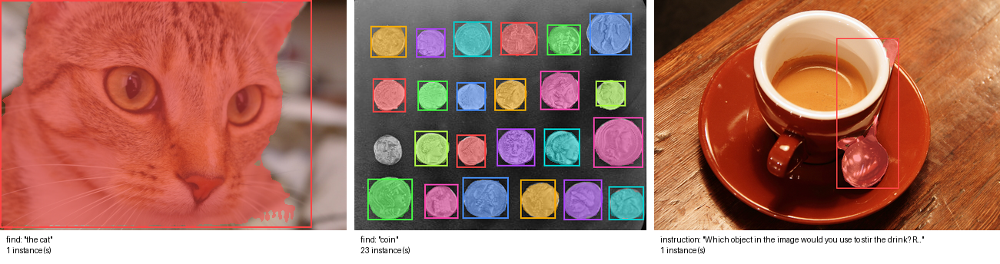

# Xiaomi-Lens-0 Segmentation for ComfyUI

Masks and boxes for **what a text describes**, inside ComfyUI, with **Xiaomi-Lens-0**
([SeerRay-Lab/Xiaomi-Lens-0](https://github.com/SeerRay-Lab/Xiaomi-Lens-0), [paper](https://arxiv.org/abs/2610.23279)), a 4B
vision-language model (Qwen3.5-4B with a pixel-mask decoder, Apache-2.0). Type "the pink dress", "coin" or a request such as
"which object would you use to stir the drink?" and get one mask and one box per instance, at the size of your image, ready for
inpainting, cut-outs or compositing. The nodes run the vendored official code and never download anything.

> **Unofficial.** This node pack is an independent integration. It is not affiliated with or endorsed by Xiaomi, the
> Xiaomi-Lens-0 authors or Comfy Org.
>
> 日本語の概要は [README.ja.md](README.ja.md) にあります。



*This pack's previews on scikit-image sample photos (CC0 / no known restrictions): "the cat"; "coin", 23 of the 24 coins, one
mask and box each; and an instruction, answered with the spoon. RTX 5090; masks and boxes are the official code's, bit for bit.*

## What it does

| Node | Purpose |
| --- | --- |
| **Xiaomi-Lens-0 Loader** | Loads the model from `models/xiaomi_lens/<name>/` onto ComfyUI's GPU (or the CPU) |
| **Xiaomi-Lens-0 Segment** | `IMAGE` + text → `mask` (all instances), `instance_masks` (one per instance), `preview`, `text` (the model's answer), `boxes` (JSON) |

- `prompt_mode` = `find`: your query is put into the README's grounding prompt, `Locate all instances in the image that match
  the description "<query>". Report bbox coordinates and masks.` `instruction`: the text is sent as typed, for questions and
  requests ("Which part of the picture would you replace to change the season to winter? Report bbox coordinates and masks.").
  The model may reason first; its whole answer is in `text`.
- Greedy decoding, as upstream's `infer.py`. `threshold` 0.5 is upstream's; 0 gives soft masks (the probabilities).
- The model sees the image resized to multiples of 32 pixels (at most 8.4 megapixels, the processor's limit); its masks are
  resized back to your image's size. Boxes are in pixels of your image (and in the model's 0-1000 scale) in `boxes`.
- Batches: every image is segmented on its own. With no instance found, the masks are empty (not an error).
- `instance_masks` is a mask batch, one per instance in answer order (the colors of `preview` follow the same order).

Typical uses: **Segment → Grow Mask → an inpainting sampler** (replace what you described); **Segment → Invert Mask → Join Image
with Alpha** (cut-out, the shipped `cut_out.json`); **instance_masks → per-object edits**.

| RTX 5090 (bfloat16) | Time | VRAM peak |
| --- | --- | --- |
| One object, image up to 1 MP | 1.5 – 3 s | 9.2 GB |
| 23 instances (`coin`, 0.1 MP) | 29 s (the answer is long) | 9.2 GB |
| One object, 8 MP image | 6 s | 15 GB |

On the CPU (24 threads, bfloat16, about 10 GB of RAM) one object in a 0.14 MP photo took 6.6 s, with the same box as on the GPU.
Measured here with the model loaded (loading takes 5–10 s). Without the optional `causal-conv1d` and `flash-linear-attention`
packages Transformers runs Qwen3.5's linear-attention layers in plain PyTorch, which is correct but slower on long answers.

## How far it was checked

Windows 11, RTX 5090, ComfyUI v0.42.1; details and raw numbers in [docs/VERIFICATION.md](docs/VERIFICATION.md):

- **Bit-identical to the official code.** On six images (one object, 23 coins, a reasoning request) the pack's answers, boxes
  and mask logits equal those of upstream's `infer.py` steps on the real model, byte for byte, in 6 of 6 cases, with Transformers
  5.4.0 (the version upstream tested) and 5.20.1, and with both of the decoder kernels below. The official code itself gives
  identical bytes run to run.
- **Real ComfyUI queue on the RTX 5090:** the three shipped workflows on ComfyUI's own `example.png`; the saved masks, the
  previews and the cut-out's alpha equal the official output pixel for pixel, the instruction's answer is the official text.
- **CI** (GitHub Actions; Ubuntu and Windows; ComfyUI v0.38.0 and v0.42.1; Transformers 5.4.0 and the newest): a tiny checkpoint
  with the real architecture and tokenizer, the pack compared with the official `infer.py` in the same process, the vendored code
  compared with the pinned upstream commit, ComfyUI's validation of the workflows, and a real ComfyUI queue compared with the
  official output pixel for pixel.

**Not checked:** segmentation quality itself (the pack reproduces the official outputs; it does not re-evaluate the model; see
the authors' benchmarks), flash-attn (not available on Windows; on Linux with flash-attn installed the `auto` settings use it as
upstream does), Linux and macOS outside CI, AMD or Apple GPUs, GPUs other than the RTX 5090.

## Install

1. ComfyUI with the V3 node API (**v0.38.0** or later), Python 3.10+, **Transformers 5.4.0 or newer** (Qwen3.5 support). A CUDA
   GPU is recommended: the measured peaks are 9.2 GB of VRAM for images up to 1 MP and 15 GB at 8 MP.
2. Clone this repository into `ComfyUI/custom_nodes/` and install its requirement into ComfyUI's Python:

   ```
   git clone https://github.com/hiroki-abe-58/ComfyUI-XiaomiLens custom_nodes/ComfyUI-XiaomiLens
   python -m pip install -r custom_nodes/ComfyUI-XiaomiLens/requirements.txt
   ```

   If your ComfyUI still has Transformers 4.x, this upgrades it to 5.x; other custom nodes that need 4.x may then break.

3. Download the model (9.2 GB). The script pins the revision and verifies every file's SHA-256:

   ```
   python custom_nodes/ComfyUI-XiaomiLens/tools/download_model.py --models-dir models/xiaomi_lens
   ```

   Result: `models/xiaomi_lens/Xiaomi-Lens-0/` with the repository's files (`config.json`, three `.safetensors` shards, tokenizer
   and processor files, `LICENSE`, the model card). Another location works through `extra_model_paths.yaml` with the key
   `xiaomi_lens`.

4. Restart ComfyUI and open one of `workflows/gui/` (they use ComfyUI's own `example.png`):
   - `segment_object.json`: "the pink dress" → mask, preview, boxes;
   - `cut_out.json`: "the cartoon character" → PNG with the background transparent;
   - `reasoning_segment.json`: an instruction ("which part would you replace to change the season to winter?") → the grass.

## Loader settings

- `device`: `auto` = ComfyUI's GPU; `cpu` works (slower, and the time grows with the image size and the answer length).
- `attention` (the language model and vision encoder): `auto` = FlashAttention-2 when flash-attn is installed and the model runs
  on CUDA (what upstream uses), otherwise PyTorch SDPA; `eager` for debugging.
- `decoder_attention` (the mask decoder): `auto` = flash-attn when installed (upstream's default), otherwise **SDPA**. `mha` is
  what upstream falls back to without flash-attn; it gives upstream's exact bytes there, but it holds the whole patch-by-patch
  attention matrix: about 2 GB for a 2 MP image and over 30 GB at 8 MP (it ran out of memory on the RTX 5090). SDPA and MHA give
  the same answers and boxes; their masks agree to an IoU of 0.997 or more (VERIFICATION.md).
- `after_run`: `keep on device` for fast repeated runs, `move to CPU` to free about 9 GB of VRAM after each run (for workflows
  that then load a large image model).

## Notes and limits

- The model reads the image and the text; what it finds is its own judgment (it can miss objects or merge them, as in the
  authors' limitations). Reasoning answers can be long; `max_new_tokens` caps them (upstream's default 16384).
- Interrupt stops generation between two tokens.
- The model was trained for English requests; other languages are untested here.
- Transformers versions change the low digits of the result: 5.4.0 and 5.20.1 gave the same answer in 4 of 6 cases and masks
  with an IoU of 0.975 or more (VERIFICATION.md). Within one setup the results repeat exactly.

## Licenses

- This node pack's code: **MIT** ([LICENSE](LICENSE)).
- Vendored Xiaomi-Lens-0 code (`xiaomi_lens_comfy/vendor`): **Apache-2.0**, Copyright 2026 Xiaomi Corporation; one line modified
  ([NOTICE](NOTICE), `xiaomi_lens_comfy/vendor/UPSTREAM.md`).
- Model (downloaded only by `tools/download_model.py`): **Apache-2.0** (model card), derived from Qwen3.5-4B (Apache-2.0).

## Development

```
python -m pip install pytest ruff
python tools/download_model.py --models-dir <files> --no-weights                     # 20 MB: configuration and tokenizer
python scripts/make_tiny_model.py --source <files>/Xiaomi-Lens-0 --out <tiny>/Xiaomi-Lens-0
git clone https://github.com/SeerRay-Lab/Xiaomi-Lens-0 <upstream> && git -C <upstream> checkout 157b7bcb0b5010e81df858f5e9e4aa55a2fa9819
XL_TINY_DIR=<tiny>/Xiaomi-Lens-0 XL_UPSTREAM_DIR=<upstream> XL_COMFYUI_DIR=<ComfyUI checkout> python -m pytest tests
python scripts/ci_queue_check.py --comfyui <ComfyUI checkout> --models-dir <tiny> --upstream <upstream>         # real queue, CPU
python scripts/ci_queue_check.py --comfyui <ComfyUI checkout> --models-dir models/xiaomi_lens --upstream <upstream> --gpu   # real model
python scripts/vendor_sync.py --upstream <upstream> --check                                                     # vendored code check
```
